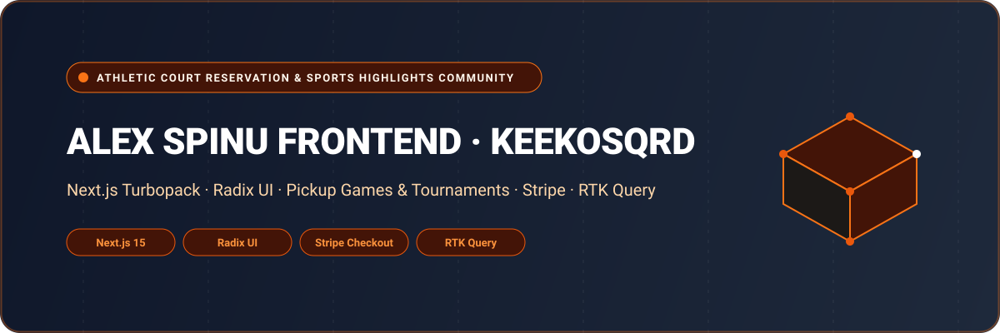

<div align="center">



# Alex Spinu Frontend (Keekosqrd) — Athletic Court Booking & Sports Community Platform

A full-featured sports community web application enabling basketball and athletic court reservations, pickup match coordination, video highlight reels, and coach booking. Built with **Next.js 15 (Turbopack, App Router)**, **Radix UI**, **Headless UI**, **Stripe Payments**, **Redux Toolkit**, and **Tailwind CSS**.

[](https://nextjs.org/)
[](https://www.radix-ui.com/)
[](https://stripe.com/)
[](https://redux-toolkit.js.org/)
[](https://www.typescriptlang.org/)
[](LICENSE)

</div>

---

## 🌟 Overview

**Keekosqrd (Alex Spinu Frontend)** is a dedicated social sports platform for basketball and athletic players. It unifies local court discovery, live reservation scheduling, and social pickup games with video highlight reels and player leaderboard rankings.

Athletes can find nearby public and private courts, book practice slots, challenge other local players, hire verified coaches, and share their best game plays with the broader athletic community.

---

## 🚀 Key Features & Capabilities

- 🏀 **Court Reservation Engine**: Interactive map and list of indoor/outdoor courts with real-time slot availability, hourly rates, and amenities.
- 🤝 **Pickup Games & Matchmaking**: Create or join open pickup games, manage team rosters, set skill levels, and invite players.
- 🎥 **Video Highlights & Media Feed**: Upload short video highlight clips, like and comment on community plays, and build a digital athletic mixtape.
- 🏋️ **Certified Coach Booking**: Browse sports trainers, check specialized coaching credentials, and book 1-on-1 private training sessions.
- 🏆 **Player Leaderboards & Rankings**: Track games played, MVP awards, community skill endorsements, and regional leaderboards.
- 💳 **Stripe Payment Integration**: Secure credit card checkout for court rentals, tournament registrations, and training fees.

---

## 🏛️ System Architecture

```
[ Athletic Players & Coaches ]
              │
              ▼
   [ Next.js 15 Turbopack App Router Portal ]
   ├── Court Discovery & Slot Booking Engine
   ├── Pickup Games & Match Coordination
   ├── Video Highlights Feed (Reel Uploader & Player)
   ├── Coach Directory & Session Scheduler
   └── Player Rankings & Profile Statistics
              │
              ▼ (RTK Query / HTTPS REST)
   [ Keekosqrd Backend API & Cloud Storage ]
```

---

## 📁 Repository Structure

```
alex_spinu_frontend/
├── assets/
│   └── banner.svg                  # Architectural SVG project banner
├── public/                         # Sports icons, court imagery, and brand marks
├── src/
│   ├── app/
│   │   ├── (auth)/                 # Registration, login, password recovery
│   │   ├── (dashboard)/(user)/     # Core application modules
│   │   │   ├── all-court/          # Master court directory
│   │   │   ├── courts/             # Court detail, availability & booking
│   │   │   ├── all-games/          # Public match listings
│   │   │   ├── my-games/           # Scheduled matches & team rosters
│   │   │   ├── join-game/          # Match signup workflow
│   │   │   ├── highlights/         # Video highlight community feed
│   │   │   ├── upload-highlight/   # Media clip uploader
│   │   │   ├── coaching/           # Certified trainer booking
│   │   │   ├── player-list/        # Community athlete directory
│   │   │   ├── rankings/           # Leaderboards & competitive tiers
│   │   │   └── profile/            # Player profile, bio, achievements
│   │   ├── layout.tsx              # Root HTML wrapper with Redux & Theme Providers
│   │   └── globals.css             # Tailwind CSS tokens & styling
│   ├── components/                 # Court cards, video reels, booking modals
│   ├── redux/                      # Redux Toolkit store and RTK Query endpoints
│   └── lib/                        # Formatting utilities, auth helpers
├── .env.example                    # Sanitized environment template
├── package.json                    # Dependencies (Next.js 15, Radix UI, Stripe)
└── tsconfig.json                   # Strict TypeScript compiler options
```

---

## 💻 Tech Stack Specification

| Domain | Selected Technologies |
| :--- | :--- |
| **Framework** | Next.js 15 (Turbopack, App Router) |
| **Language** | TypeScript 5 (Strict Mode) |
| **UI Components** | Radix UI Primitives, Headless UI, Lucide Icons |
| **Payments** | Stripe (@stripe/stripe-js, @stripe/react-stripe-js) |
| **State Management** | Redux Toolkit (RTK), RTK Query |
| **Styling** | Tailwind CSS 3.4, PostCSS, Tailwind-Merge |
| **Forms & Validation** | React Hook Form, Zod Resolver |

---

## 🛠️ Getting Started & Local Development

### Prerequisites

- **Node.js**: `v20.x` or higher
- **Package Manager**: `npm`, `yarn`, or `pnpm`

### 1. Clone the Repository

```bash
git clone https://github.com/shahjalal-labs/alex_spinu_frontend.git
cd alex_spinu_frontend
```

### 2. Install Dependencies

```bash
npm install
```

### 3. Configure Environment Variables

Create a `.env.local` file:

```env
NEXT_PUBLIC_BASE_URL_LOCAL=http://localhost:5000/api/v1
NEXTAUTH_URL=http://localhost:3000
NEXTAUTH_SECRET=sample_secret_key
NEXT_PUBLIC_GOOGLE_MAPS_API_KEY=sample_google_maps_key
```

### 4. Run Development Server

```bash
npm run dev
```

Open [http://localhost:3000](http://localhost:3000) to view the application.

---

## 👨‍💻 Engineering & Authorship

Developed and engineered by **Md. Shahjalal**.

- **GitHub**: [@shahjalal-labs](https://github.com/shahjalal-labs)
- **Email**: [muhommodshahjalal@gmail.com](mailto:muhommodshahjalal@gmail.com)

---

## 📄 License

This project is open-source and available under the [ISC License](LICENSE).
